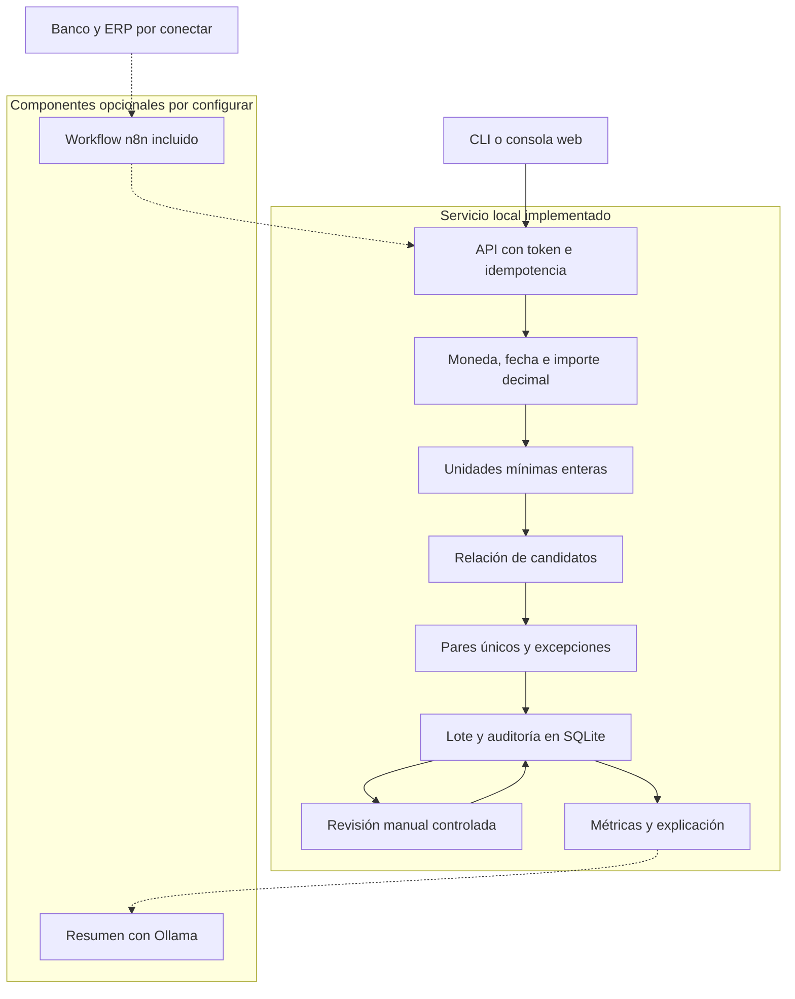

# Arquitectura

[Abrir SVG](diagrams/architecture.svg) · [Fuente Mermaid](diagrams/architecture.mmd)

Dos conjuntos de movimientos atraviesan la misma validación monetaria. El motor propone sólo coincidencias únicas y conserva las ambigüedades para una revisión explícita.

Versión Mermaid

Las líneas continuas muestran el recorrido implementado dentro de cada límite. Las líneas discontinuas indican componentes opcionales, entregados para configurar o aún por conectar; su estado se precisa en [tecnologías](technologies.md).

El dominio construye una relación de candidatos donde referencia normalizada, importe, moneda y fecha satisfacen las reglas. La conciliación automática acepta solamente un banco con un candidato que a su vez tenga un solo banco candidato. La selección no depende del orden del archivo.

Los importes se validan antes de convertirlos a enteros. La diferencia se calcula por moneda sobre todos los movimientos del lote. Una coincidencia no modifica saldos ni crea asientos: registra una relación entre identificadores.

La tabla `reconciliations` conserva una huella del origen normalizado, el origen y el resultado. Un mismo identificador de lote con otro contenido se rechaza. Las revisiones actualizan el resultado, preservan el origen y registran eventos de auditoría dentro de la transacción de solicitud.

El servicio no hace inferencias sobre la causa de diferencias. El resumen opcional recibe cantidades de excepciones y métricas agregadas, y no puede llamar herramientas de pago.

[Flujo de operación](flow.md) · [Tecnologías y alcance](technologies.md)
