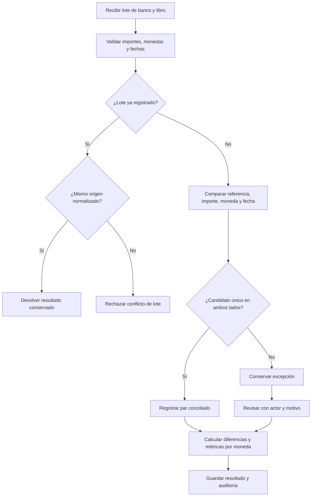

# Flujo de operación

[Abrir SVG](diagrams/flow.svg) · [Fuente Mermaid](diagrams/flow.mmd)

Versión Mermaid

- La conciliación automática no depende del orden de entrada y no convierte divisas.
- La revisión puede vincular movimientos pendientes, sin alterar importes ni monedas ni reutilizar un movimiento.
- `explain` recibe métricas agregadas; el texto opcional no autoriza pagos ni reemplaza el resultado estructurado.

Las operaciones del dominio se guardan junto a auditoría y respuesta idempotente en la transacción del servicio local. Un error revierte los cambios de esa solicitud.

[Arquitectura](architecture.md) · [Tecnologías y alcance](technologies.md)
